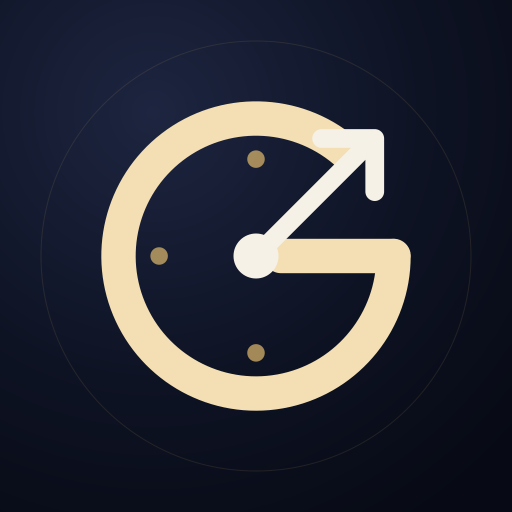
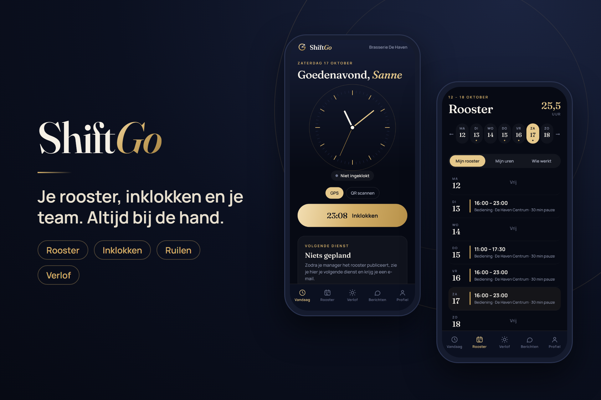
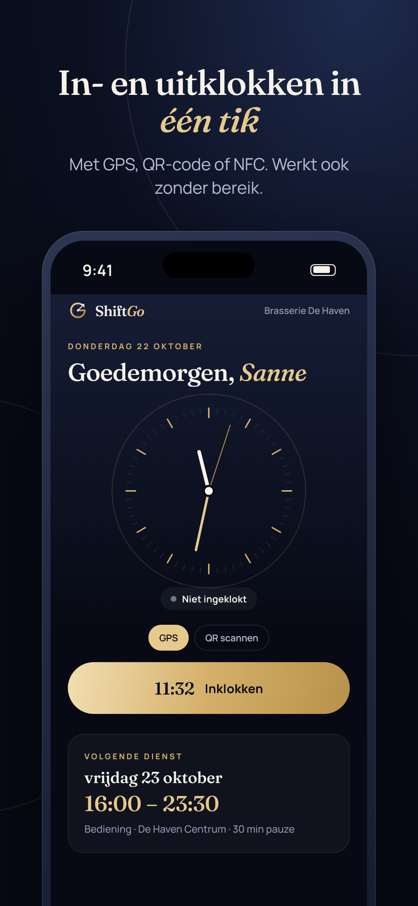
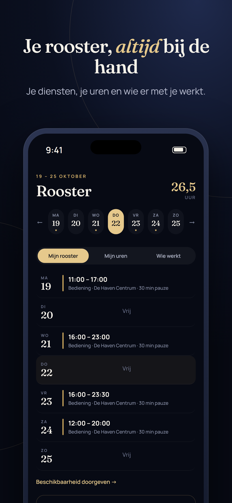
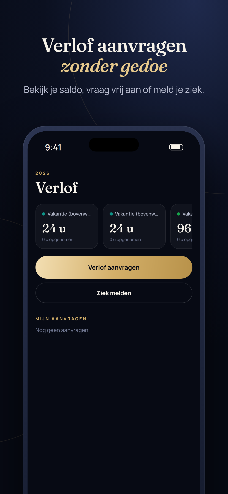
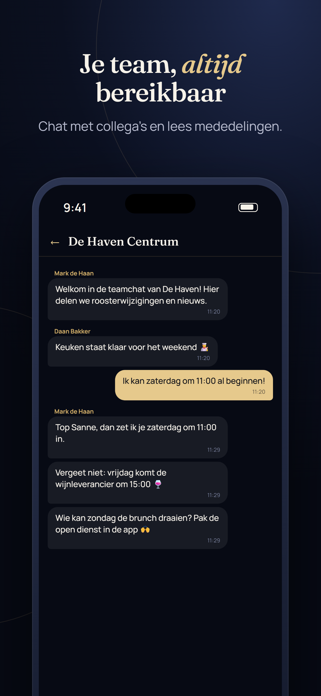

  

<h1 align="center">ShiftGo</h1>

<b>Roosters en prikklok voor horeca, retail en elk team dat in diensten werkt.</b>

  <a href="https://shiftgo.nl">shiftgo.nl</a> ·
  <a href="https://play.google.com/store/apps/details?id=app.shiftgo.mobile">Google Play</a> ·
  App Store (binnenkort)

## Wat is ShiftGo?

ShiftGo regelt het rooster en de uren van je team, op de website en in de app voor Android en iPhone.

**Roosteren**
- Planbord per week met sjablonen, benodigde bezetting en automatisch inplannen
- Loonkosten en budget per dag en week, ook ten opzichte van de omzet
- Rooster publiceren; medewerkers krijgen direct bericht
- Open diensten, ruilen met collega's en vervanging zoeken

**Klokken**
- In- en uitklokken met GPS, QR-code, NFC-tag of een kiosk-tablet met pincode
- Werkt ook zonder internet en wordt later verstuurd
- Uren goedkeuren en exporteren naar je salarisadministratie

**Voor het hele team**
- Beschikbaarheid, verlof en ziekmeldingen
- Chat en mededelingen, met foto's
- De app in het Nederlands, Engels, Pools, Turks en Spaans

  
  
  
  

## Aan de slag

Probeer ShiftGo gratis op **[shiftgo.nl](https://shiftgo.nl)**. Tot 10 medewerkers is het gratis.

## Contact

Vragen of een demo? Mail naar [info@shiftgo.nl](mailto:info@shiftgo.nl).

---

Dit is de openbare informatiepagina van ShiftGo. De broncode van ShiftGo is niet openbaar.
